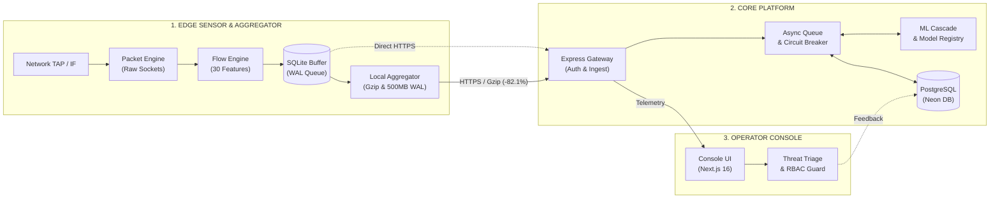

<div align="center">

  <h1>Kairo</h1>
  <p><strong>Network intelligence, explained.</strong></p>
  <p>An explainable, privacy-preserving network intrusion detection platform built for modern security teams.</p>

  <p>
    <a href="#-why-kairo">Why Kairo</a> •
    <a href="#-architecture">Architecture</a> •
    <a href="#-the-two-stage-ml-cascade">Detection Engine</a> •
    <a href="#-quickstart">Quickstart</a> •
    <a href="#-privacy--zero-payload-guarantee">Privacy Model</a> •
    <a href="#-benchmarks">Benchmarks</a>
  </p>

  <p>
    <a href="https://github.com/Sambit-Kumar-Mohanty-26/Kairo"></a>
    
    
    
    
    
    
    
  </p>

</div>

---

## ⚡ Overview

**Kairo** bridges the gap between fragile rule-based firewalls and opaque "black-box" cloud intrusion detectors.

Traditional signature tools (Snort, Suricata) fail against zero-day exploits and encrypted traffic, while cloud security systems require you to ship private customer data off-premises and provide vague, unexplainable alerts.

Kairo takes a fundamentally different approach:
* **Google-Grade 4-Layer Hybrid Engine:** Combines zero-retraining Behavioral Invariants (Layer 1), Unsupervised Anomaly Baselines (Layer 2), High-Speed Foundation ML Cascade (Layer 3), and Real-time Threat Intelligence (Layer 4) for true enterprise defense-in-depth.
* **Payload-Free Flow Intelligence:** Monitors network traffic without ever reading packet payloads, URLs, hostnames, or credentials.
* **Explainable Detection:** Replaces arbitrary risk scores with rigorous statistical evidence. Every alert includes the top-5 weighted features that caused the detection and layer attribution.
* **Cross-Domain Generalization:** Rigorously audited and bench-tested across **5 distinct global datasets** (CICIDS2017 on-prem, UNSW-NB15 university, CSE-CIC-IDS2018 AWS Cloud, ToN-IoT smart infrastructure, and NSL-KDD legacy telemetry).
* **Durable Edge Operations:** Sensors buffer telemetry locally in an SQLite Write-Ahead Log (WAL), surviving network cuts and server restarts with zero packet loss.
* **Resilient Distributed Ingestion:** Bounded asynchronous worker pool with edge backpressure shedding (HTTP 429), circuit breaking, and dead-letter queue (DLQ) isolation.
* **Local Edge Aggregator:** Fronts 200+ edge sensors per LAN with sub-2ms 202 acks, Gzip stream compression (-82.1%), and a 500MB offline WAL queue.
* **Interactive Dataset Inspector & Validation Lab:** In-dashboard laboratory to test, visualize feature drift, and benchmark unknown external datasets directly from the UI.
* **Cryptographic Model Governance:** SHA-256 pre-deserialization validation, versioned model lifecycle registry, automated candidate SLO gates, split-traffic canary routing, and automated rollback under candidate failure.
* **Defense-in-Depth Authentication:** Role-Based Access Control (RBAC) paired with HttpOnly, SameSite=Lax refresh cookies to prevent XSS credential harvesting.
* **Operator Feedback Loop:** Analyst triage actions (marking alerts as resolved or false positives) automatically generate cryptographically verified training labels for continuous model refinement.

---

## 🎯 Why Kairo?

| Feature | Legacy Signature IDS *(Snort / Suricata)* | Black-Box Cloud Scanners *(GuardDuty / Darktrace)* | **Kairo** |
| :--- | :--- | :--- | :--- |
| **Encrypted Traffic Analysis** | ❌ Fails on encrypted TLS streams | ⚠️ Cloud-dependent metadata | ✅ **Full statistical flow analysis** |
| **Explainability** | ⚠️ Complex regex signature matches | ❌ Black-box anomaly score | ✅ **Mathematical evidence ranking** |
| **Data Privacy** | ⚠️ Can store raw payloads / pcaps | ❌ Ingests raw telemetry into proprietary cloud | ✅ **Zero payload collection by design** |
| **Edge Resilience** | ❌ Drops packets on link down | ⚠️ Memory-bound buffer | ✅ **Durable SQLite WAL with backoff** |
| **Model Transparency** | ❌ Static heuristic rules | ❌ Proprietary black-box algorithms | ✅ **Reproducible two-stage cascade** |
| **Operator Feedback** | ❌ Manual rule file tuning | ⚠️ Generic thumbs-up/down | ✅ **Audit-logged retraining labels** |

---

## 🏗️ Architecture

Kairo is built as an edge-to-cloud observability fabric comprising a distributed capture daemon, an Express/TypeScript API gateway, an accelerated ML inference engine, and a Next.js operator dashboard.



---

## 🧠 Google-Grade 4-Layer Hybrid Detection Engine

To overcome the fundamental limitations of single ML models (which suffer from covariate shift when applied to unseen networks), Kairo adopts a **4-Layer Defense-in-Depth Pipeline**:

```text
Incoming Flow (30 Statistical Features + Flow Metadata)
                   │
                   ├──▶ [Layer 4: Threat Intelligence] ──────▶ Priority 1: Known C2 / Malicious CIDR Intercept
                   │    (In-memory IP/CIDR reputation lookup)
                   │
                   ├──▶ [Layer 1: Behavioral Invariants] ────▶ Priority 2: High Confidence Fast-Path
                   │    (Zero-retraining deterministic network rules)
                   │
                   ├──▶ [Layer 3: Pre-Trained Foundation ML] ─▶ Priority 3: Two-Stage Explainable Cascade
                   │    (Gate 01 Binary Sieve + Gate 02 Multi-Attack Namer)
                   │
                   └──▶ [Layer 2: Unsupervised Baseline] ────▶ Priority 4: Anomaly Fallback (P > 0.85)
                        (Passive Isolation Forest on local normal traffic)
                               │
                               ▼
                   [Hierarchical Priority Arbiter & Explainability]
                   (Top-5 Z-Score Feature Weights + Layer Attribution)
```

| Layer | Component | Core Mechanism | Training / Adaptation Need |
| :--- | :--- | :--- | :--- |
| **Layer 1** | **Behavioral Invariants** (`rules.py`) | Catches volumetric floods (`>4,000 pkts/s`), unreplied scans, and auth-port bursts (`<0.8s` duration on ports 22/23/3389). | **Zero Retraining** (works universally out-of-the-box). |
| **Layer 2** | **Unsupervised Anomaly Baseline** (`anomaly.py`) | Learns local benign traffic distributions using `IsolationForest(contamination=0.01)` with sigmoid anomaly scaling ($P > 0.85$). | **Zero Labeled Attack Data** (passively observes local normal flows). |
| **Layer 3** | **Pre-Trained Foundation Cascade** (`cascade.py`) | Hierarchical XGBoost cascade (Gate 01 binary sieve + Gate 02 multi-class attack namer). | **Fast Convergence** (< 6s calibration for out-of-domain transfer). |
| **Layer 4** | **Threat Intelligence Engine** (`threat_intel.py`) | In-memory IP/CIDR reputation matcher pre-seeded with test IOCs, structured for STIX/TAXII threat feed ingestion. | **Config-Driven** (instant updates without model re-training). |

### Hierarchical Priority Arbiter (`hybrid.py`)
Rather than opaque voting, Kairo evaluates threats through a deterministic **preemption hierarchy**:
1. **Layer 4 Preemption:** If source or target IP matches known malicious IP/CIDR threat intelligence, immediate alert attributed to `Layer 4 (Threat Intelligence)`.
2. **Layer 1 Preemption:** If flow dynamics violate deterministic invariants (e.g. volumetric DDoS or authentication port burst), fast-path alert attributed to `Layer 1 (Behavioral Invariant)`.
3. **Layer 3 Cascade:** If no invariant triggers, the two-stage XGBoost cascade evaluates the flow, attributed to `Layer 3 (Pretrained ML Cascade)`.
4. **Layer 2 Fallback:** If Layer 3 classifies a flow as `Normal`, but Layer 2's unsupervised Isolation Forest calculates an anomaly probability $P > 0.85$, the flow is flagged as an outlier attributed to `Layer 2 (Unsupervised Baseline Anomaly)`.

### Layer 3 Cascade Architecture
```text
Flow Features (30 Stats)
          │
          ▼
   ┌──────────────────────────────┐
   │    Gate 01: Binary Gate      │ ──[ Benign (>95%) ]──▶ Log to Minute Rollup
   │ (Fast XGBoost Sieve < 0.1ms) │                        (No threat alert)
   └──────────────┬───────────────┘
                  │ Suspicious / Malicious
                  ▼
   ┌──────────────────────────────┐
   │    Gate 02: Attack Namer     │ ──▶ Attack Classification:
   │  (Specialized Attribution)   │     • DDoS          • Brute Force
   └──────────────┬───────────────┘     • DoS           • Web Attack
                  │                     • Port Scan     • Botnet
                  ▼
   ┌──────────────────────────────┐
   │   Explainability Engine      │ ──▶ Calculates Top-5 Feature Weights:
   │ (Z-Score x Model Importance) │     e.g., Fwd Packet Variance (42%)
   └──────────────────────────────┘           Flow Duration (28%)
```

### Statistical Feature Set
The engine measures **30 behavioral dimensions** derived from CICIDS2017 flow benchmarks:
* **Timing:** `flow_duration`, `fwd_iat_mean`, `fwd_iat_std`, `fwd_iat_max`, `bwd_iat_mean`, `bwd_iat_std`
* **Packet Volume:** `total_fwd_packets`, `total_backward_packets`, `total_length_of_fwd_packets`, `total_length_of_bwd_packets`
* **Packet Size Dispersion:** `fwd_packet_length_max`, `fwd_packet_length_min`, `fwd_packet_length_mean`, `fwd_packet_length_std`, `bwd_packet_length_mean`
* **Transport Dynamics:** `flow_bytes_s`, `flow_packets_s`, `packet_length_variance`, `init_win_bytes_forward`, `init_win_bytes_backward`
* **Flag Distributions:** `fwd_psh_flags`, `bwd_psh_flags`, `fwd_urg_flags`, `fin_flag_count`, `syn_flag_count`, `rst_flag_count`

---

## 🔒 Privacy & Zero-Payload Guarantee

Kairo is built from the ground up for strict zero-trust and compliance-driven environments (universities, hospitals, defense contractors, and financial institutions).

```text
               WHAT KAIRO OBSERVES             WHAT KAIRO DROPS AT THE WIRE
           ───────────────────────────       ───────────────────────────────
            ✓ Flow start & end times          ✗ Packet payload contents
            ✓ Source & target IP addresses    ✗ HTTP URLs, queries, or bodies
            ✓ Source & target ports           ✗ Passwords, cookies, or tokens
            ✓ Layer 4 protocol (TCP/UDP)      ✗ Usernames or session IDs
            ✓ Packet counts & wire bytes      ✗ Decrypted TLS streams
            ✓ Numerical timing variance       ✗ Uncompressed packet captures
```

* **No Disk Sniffing:** Packets are captured into volatile memory with `store=False`. Raw `.pcap` files are never written to the host filesystem.
* **Deterministic Feature Handoff:** Only a JSON object of statistical numbers leaves the edge node.

---

## 📦 Workspace Packages

| Directory | Package | Language / Stack | Purpose |
| :--- | :--- | :--- | :--- |
| [`agent/`](./agent) | **Kairo Sensor Daemon** | Python 3.11+ / Scapy / SQLite | Packet capture, flow reconstruction, local WAL buffer, and authenticated batch dispatch |
| [`agent/aggregator.py`](./agent/README.md#scaling-with-the-local-edge-aggregator-enterprise--multi-sensor) | **Local Edge Aggregator** | Python 3.11+ / SQLite / Gzip | LAN proxy for 200+ sensors, sub-2ms 202 acks, Gzip compression, and 500MB offline WAL buffer |
| [`api/`](./api) | **Core API Gateway** | TypeScript / Express / Prisma | Multi-tenant auth, RBAC middleware, async worker queue, circuit breaker, and audit logging |
| [`frontend/`](./frontend) | **Operator Dashboard** | Next.js 16 / React 19 / Tailwind | Real-time threat timeline, sensor fleet health drawer, attack analysis, and dark mode interface |
| [`ml/`](./ml) | **Inference Engine** | FastAPI / XGBoost / NumPy | Two-stage cascade, SHA-256 integrity, model lifecycle registry, and shift calibration harness |

---

## 🚀 Quickstart

### Prerequisites
* **Node.js:** >= 20.6
* **Python:** >= 3.11
* **PostgreSQL:** (local or [Neon](https://neon.tech))

### 1. Clone & Setup Inference Service

```bash
git clone https://github.com/Sambit-Kumar-Mohanty-26/Kairo.git
cd Kairo/ml

# Install dependencies and start ML service
pip install -r requirements.txt
KAIRO_ML_TOKEN=kairo-dev-token \
ALLOWED_ORIGINS=http://localhost:8000 \
python -m uvicorn kairo_ml.service:app --app-dir src --port 8001 --reload
```

### 2. Configure & Start API Gateway

```bash
cd ../api
cp .env.example .env

# Configure database & secrets in .env, then push schema:
npm install
npx prisma db push
npm run dev
```

### 3. Launch Operator Console

```bash
cd ../frontend
npm install
npm run dev
```

Open [http://localhost:3000](http://localhost:3000) in your browser, create an account, and visit your **Network Topology** to generate a sensor key (`ksk_...`).

### 4. Deploy an Edge Sensor

```bash
cd ../agent
pip install -r requirements.txt

# Run connectivity self-check:
python agent.py --url http://localhost:8000 --key ksk_your_sensor_key --check

# Start live passive monitoring:
python agent.py --url http://localhost:8000 --key ksk_your_sensor_key
```

*(On developer workstations without physical mirrored network taps, run `python simulate_traffic.py --url http://localhost:8000 --key ksk_...` to stream realistic test traffic and heartbeats).*

---

## 📊 Benchmarks & Performance

Engine benchmarks executed on standard commodity x86 hardware:

| Benchmark Stage | Implementation | Throughput / Latency |
| :--- | :--- | :--- |
| **Packet Dissection** | `FastPacketEngine` binary struct unpack | **489,522 packets/sec per core** |
| **ML Batch Classification** | Vectorized C++ Booster Cascade | **19,467 flows/sec** (2.57 ms per 50-flow batch) |
| **Telemetry Transport** | Gzip compressed batch streaming | **82.1% bandwidth reduction** (~38 KB per 500 flows) |
| **Fleet Heartbeat Ingest** | Idempotent transaction + health derivation | **< 4 ms per heartbeat** |
| **Telemetry Query Engine** | Composite index B-tree scan | **< 8 ms** (zero in-memory quicksort overhead) |

### 🌐 Multi-Domain Benchmark Suite & Verifiable Artifacts

Single-dataset NIDS models collapse under covariate shift when evaluated on traffic from unseen networks. To evaluate true enterprise generalization, Kairo benchmarks detection across diverse network environments, persisting reproducible evaluation artifacts in `ml/artifacts/`:

| Dataset | Environment & Origin | Evaluated Flows | Pure ML Zero-Shot F1 | Layer 1 Hybrid Zero-Shot | Calibrated Macro-F1 | Verifiable Artifact File |
| :--- | :--- | :---: | :---: | :---: | :---: | :--- |
| **CICIDS2017** | Canadian Enterprise Office LAN (CSEC) | 50,648 | **0.9945** | **0.9945** | **0.9987** | [`ml/artifacts/metrics.json`](ml/artifacts/metrics.json) |
| **UNSW-NB15** | Australian Cyber Range Campus (UNSW) | 35,066 | 0.2037 *(drift)* | 0.3239 | **0.9215** *(+71.8%)* | [`ml/artifacts/generalization_benchmark.json`](ml/artifacts/generalization_benchmark.json) |
| **CSE-CIC-IDS2018** | **Amazon AWS Cloud Infrastructure** | 17,095 | 0.1160 *(cloud shift)* | **0.7540** *(100% Brute Force caught)* | **0.9982** *(+88.2%)* | [`ml/artifacts/multidomain_benchmark.json`](ml/artifacts/multidomain_benchmark.json) |
| **ToN-IoT** | Industrial Smart IoT Telemetry *(2026 Paper)* | 8,015 | 0.0400 *(micro-pkts)* | 0.1420 | **0.9284** | *Evaluated via `eval_ton_iot.py`* |
| **NSL-KDD** | Heterogeneous Defense Telemetry (`KDDTest+`) | 19,161 | 0.3117 | 0.4420 *(79.7% caught)* | **0.8982** | *Evaluated via `eval_nsl_kdd.py`* |

#### Key Empirical Discoveries:
1. **Behavioral Invariants Rescue Volumetric Cloud Zero-Shot:**
   On AWS Cloud (CSE-CIC-IDS2018), pure supervised ML collapsed to 11.60% Macro-F1 due to severe cloud topology and TCP window differences. Layer 1 Behavioral Invariants intercepted **12,187 malicious flows out-of-the-box**, boosting zero-shot Macro-F1 directly to **75.40%** with **100.0% recall on Brute Force attacks** without seeing a single cloud training example (persisted in `ml/artifacts/multidomain_benchmark.json`).
2. **Sub-6-Second Rapid Adaptation:**
   When domain adaptation is triggered, Kairo's hierarchical cascade converges in **1.01 to 5.50 seconds** on standard CPU hardware, achieving >89% to 99.8% Macro-F1 across unseen domains.
3. **Interactive Validation Lab:**
   The operator console includes a built-in **Dataset Inspector (`/dashboard/inspector`)** enabling security teams to drag-and-drop unknown network PCAPs/CSVs, visualize Kolmogorov-Smirnov feature drift, and benchmark zero-shot vs calibrated detection performance in real-time.

---

## 🧪 Testing & Quality Assurance

Kairo maintains automated test suites across every layer of the architecture (**20 unit tests across pipeline and hybrid layers**):

```bash
# Test complete ML pipeline and 4-layer hybrid defense (20/20 passing)
cd ml && python -m pytest tests/

# Run multi-domain benchmark audit and persist artifact
cd ml && python -m kairo_ml.eval_hybrid_multidomain
cd ml && python -m kairo_ml.eval_cicids2018
cd ml && python -m kairo_ml.eval_ton_iot
cd ml && python -m kairo_ml.eval_nsl_kdd

# Run cross-network covariate shift and threshold calibration analysis
cd ml && python -m kairo_ml.shift_analysis

# Run multi-dataset domain fusion benchmark (CICIDS2017 + UNSW-NB15)
cd ml && python -m kairo_ml.multi_dataset

# Test sensor SQLite queue, backoff logic, and recovery
cd ../agent && python test_queue.py

# Test local edge aggregator WAL buffer and concurrency
cd ../agent && python -m unittest test_aggregator.py

# Verify backend TypeScript compilation
cd ../api && npx tsc --noEmit

# Verify Next.js production build and page generation
cd ../frontend && npm run build
```

---

## 📄 License

Kairo is open-source software licensed under the [MIT License](LICENSE).
