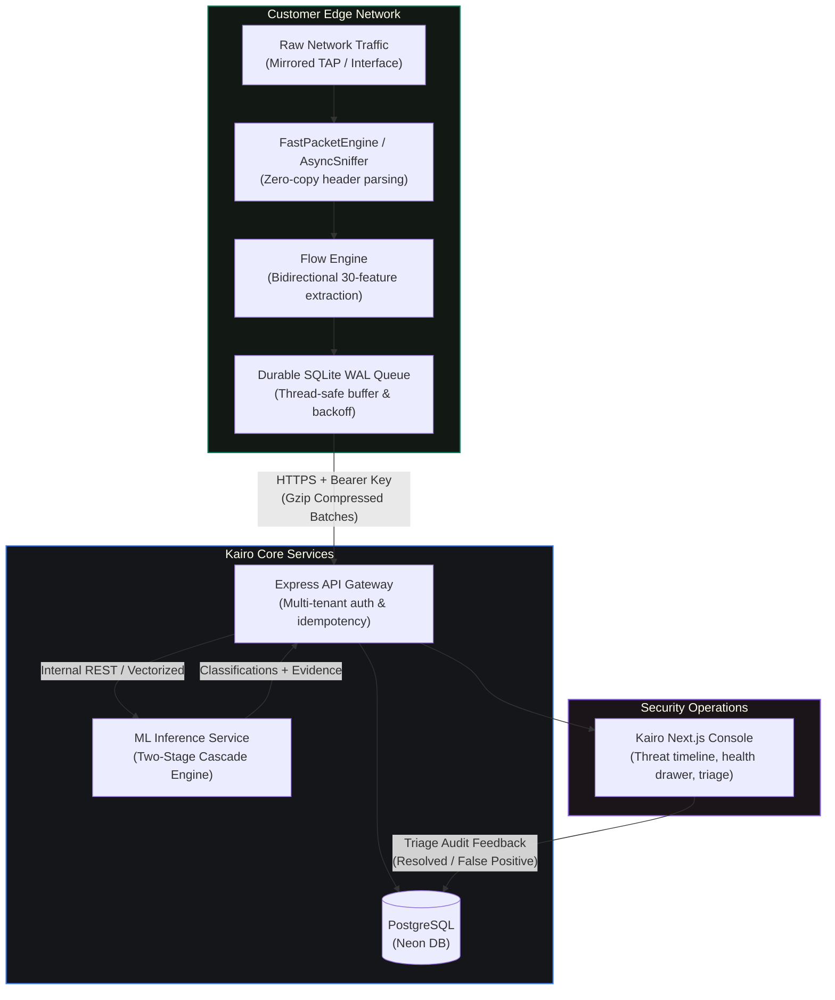

<div align="center">

  <h1>Kairo</h1>
  <p><strong>Network intelligence, explained.</strong></p>
  <p>An explainable, privacy-preserving network intrusion detection platform built for modern security teams.</p>

  <p>
    <a href="#-why-kairo">Why Kairo</a> •
    <a href="#-architecture">Architecture</a> •
    <a href="#-the-two-stage-ml-cascade">Detection Engine</a> •
    <a href="#-quickstart">Quickstart</a> •
    <a href="#-privacy--zero-payload-guarantee">Privacy Model</a> •
    <a href="#-benchmarks">Benchmarks</a>
  </p>

  <p>
    <a href="https://github.com/Sambit-Kumar-Mohanty-26/Kairo"></a>
    
    
    
    
    
    
    
  </p>

</div>

---

## ⚡ Overview

**Kairo** bridges the gap between fragile rule-based firewalls and opaque "black-box" cloud intrusion detectors.

Traditional signature tools (Snort, Suricata) fail against zero-day exploits and encrypted traffic, while cloud security systems require you to ship private customer data off-premises and provide vague, unexplainable alerts.

Kairo takes a fundamentally different approach:
* **Payload-Free Flow Intelligence:** Monitors network traffic without ever reading packet payloads, URLs, hostnames, or credentials.
* **Explainable Detection:** Replaces arbitrary risk scores with rigorous statistical evidence. Every alert includes the top-5 weighted features that caused the detection.
* **Hierarchical Cascade:** A two-stage classifier filters benign traffic at wire speed, spending compute only on suspicious flows.
* **Durable Edge Operations:** Sensors buffer telemetry locally in an SQLite Write-Ahead Log (WAL), surviving network cuts and server restarts with zero packet loss.
* **Operator Feedback Loop:** Analyst triage actions (marking alerts as resolved or false positives) automatically generate cryptographically verified training labels for continuous model refinement.

---

## 🎯 Why Kairo?

| Feature | Legacy Signature IDS *(Snort / Suricata)* | Black-Box Cloud Scanners *(GuardDuty / Darktrace)* | **Kairo** |
| :--- | :--- | :--- | :--- |
| **Encrypted Traffic Analysis** | ❌ Fails on encrypted TLS streams | ⚠️ Cloud-dependent metadata | ✅ **Full statistical flow analysis** |
| **Explainability** | ⚠️ Complex regex signature matches | ❌ Black-box anomaly score | ✅ **Mathematical evidence ranking** |
| **Data Privacy** | ⚠️ Can store raw payloads / pcaps | ❌ Ingests raw telemetry into proprietary cloud | ✅ **Zero payload collection by design** |
| **Edge Resilience** | ❌ Drops packets on link down | ⚠️ Memory-bound buffer | ✅ **Durable SQLite WAL with backoff** |
| **Model Transparency** | ❌ Static heuristic rules | ❌ Proprietary black-box algorithms | ✅ **Reproducible two-stage cascade** |
| **Operator Feedback** | ❌ Manual rule file tuning | ⚠️ Generic thumbs-up/down | ✅ **Audit-logged retraining labels** |

---

## 🏗️ Architecture

Kairo is built as an edge-to-cloud observability fabric comprising a distributed capture daemon, an Express/TypeScript API gateway, an accelerated ML inference engine, and a Next.js operator dashboard.



---

## 🧠 The Two-Stage ML Cascade

At the core of Kairo is a two-stage classifier that mirrors how senior network security analysts evaluate incidents:

```text
Incoming Flow (30 Statistical Features)
                  │
                  ▼
   ┌──────────────────────────────┐
   │    Gate 01: Binary Gate      │ ──[ Benign (>95%) ]──▶ Log to Minute Rollup
   │ (Fast XGBoost Sieve < 0.1ms) │                        (No threat alert)
   └──────────────┬───────────────┘
                  │ Suspicious / Malicious
                  ▼
   ┌──────────────────────────────┐
   │    Gate 02: Attack Namer     │ ──▶ Attack Classification:
   │  (Specialized Attribution)   │     • DDoS          • Web Attack
   └──────────────┬───────────────┘     • DoS           • Infiltration
                  │                     • PortScan      • Botnet
                  ▼
   ┌──────────────────────────────┐
   │   Explainability Engine      │ ──▶ Calculates Top-5 Feature Weights:
   │ (Z-Score x Model Importance) │     e.g., Fwd Packet Variance (42%)
   └──────────────────────────────┘           Flow Duration (28%)
```

### Statistical Feature Set
The engine measures **30 behavioral dimensions** derived from CICIDS2017 flow benchmarks:
* **Timing:** `flow_duration`, `fwd_iat_mean`, `fwd_iat_std`, `fwd_iat_max`, `bwd_iat_mean`, `bwd_iat_std`
* **Packet Volume:** `total_fwd_packets`, `total_backward_packets`, `total_length_of_fwd_packets`, `total_length_of_bwd_packets`
* **Packet Size Dispersion:** `fwd_packet_length_max`, `fwd_packet_length_min`, `fwd_packet_length_mean`, `fwd_packet_length_std`, `bwd_packet_length_mean`
* **Transport Dynamics:** `flow_bytes_s`, `flow_packets_s`, `packet_length_variance`, `init_win_bytes_forward`, `init_win_bytes_backward`
* **Flag Distributions:** `fwd_psh_flags`, `bwd_psh_flags`, `fwd_urg_flags`, `fin_flag_count`, `syn_flag_count`, `rst_flag_count`

---

## 🔒 Privacy & Zero-Payload Guarantee

Kairo is built from the ground up for strict zero-trust and compliance-driven environments (universities, hospitals, defense contractors, and financial institutions).

```text
               WHAT KAIRO OBSERVES             WHAT KAIRO DROPS AT THE WIRE
           ───────────────────────────       ───────────────────────────────
            ✓ Flow start & end times          ✗ Packet payload contents
            ✓ Source & target IP addresses    ✗ HTTP URLs, queries, or bodies
            ✓ Source & target ports           ✗ Passwords, cookies, or tokens
            ✓ Layer 4 protocol (TCP/UDP)      ✗ Usernames or session IDs
            ✓ Packet counts & wire bytes      ✗ Decrypted TLS streams
            ✓ Numerical timing variance       ✗ Uncompressed packet captures
```

* **No Disk Sniffing:** Packets are captured into volatile memory with `store=False`. Raw `.pcap` files are never written to the host filesystem.
* **Deterministic Feature Handoff:** Only a JSON object of statistical numbers leaves the edge node.

---

## 📦 Workspace Packages

| Directory | Package | Language / Stack | Purpose |
| :--- | :--- | :--- | :--- |
| [`agent/`](./agent) | **Kairo Sensor Daemon** | Python 3.11+ / Scapy / SQLite | Packet capture, flow reconstruction, local WAL buffer, and authenticated batch dispatch |
| [`api/`](./api) | **Core API Gateway** | TypeScript / Express / Prisma | Multi-tenant authentication, sensor fleet management, ingestion idempotency, and audit logging |
| [`frontend/`](./frontend) | **Operator Dashboard** | Next.js 16 / React 19 / Tailwind | Real-time threat timeline, sensor fleet health drawer, attack analysis, and dark mode interface |
| [`ml/`](./ml) | **Inference Engine** | FastAPI / XGBoost / NumPy | High-throughput two-stage cascade model, statistical evidence extraction, and benchmark harness |

---

## 🚀 Quickstart

### Prerequisites
* **Node.js:** >= 20.6
* **Python:** >= 3.11
* **PostgreSQL:** (local or [Neon](https://neon.tech))

### 1. Clone & Setup Inference Service

```bash
git clone https://github.com/Sambit-Kumar-Mohanty-26/Kairo.git
cd Kairo/ml

# Install dependencies and start ML service
pip install -r requirements.txt
KAIRO_ML_TOKEN=kairo-dev-token \
ALLOWED_ORIGINS=http://localhost:8000 \
python -m uvicorn kairo_ml.service:app --app-dir src --port 8001 --reload
```

### 2. Configure & Start API Gateway

```bash
cd ../api
cp .env.example .env

# Configure database & secrets in .env, then push schema:
npm install
npx prisma db push
npm run dev
```

### 3. Launch Operator Console

```bash
cd ../frontend
npm install
npm run dev
```

Open [http://localhost:3000](http://localhost:3000) in your browser, create an account, and visit your **Network Topology** to generate a sensor key (`ksk_...`).

### 4. Deploy an Edge Sensor

```bash
cd ../agent
pip install -r requirements.txt

# Run connectivity self-check:
python agent.py --url http://localhost:8000 --key ksk_your_sensor_key --check

# Start live passive monitoring:
python agent.py --url http://localhost:8000 --key ksk_your_sensor_key
```

*(On developer workstations without physical mirrored network taps, run `python simulate_traffic.py --url http://localhost:8000 --key ksk_...` to stream realistic test traffic and heartbeats).*

---

## 📊 Benchmarks & Performance

Engine benchmarks executed on standard commodity x86 hardware:

| Benchmark Stage | Implementation | Throughput / Latency |
| :--- | :--- | :--- |
| **Packet Dissection** | `FastPacketEngine` binary struct unpack | **489,522 packets/sec per core** |
| **ML Batch Classification** | Vectorized C++ Booster Cascade | **19,467 flows/sec** (2.57 ms per 50-flow batch) |
| **Telemetry Transport** | Gzip compressed batch streaming | **82.1% bandwidth reduction** (~38 KB per 500 flows) |
| **Fleet Heartbeat Ingest** | Idempotent transaction + health derivation | **< 4 ms per heartbeat** |
| **Telemetry Query Engine** | Composite index B-tree scan | **< 8 ms** (zero in-memory quicksort overhead) |

---

## 🧪 Testing & Quality Assurance

Kairo maintains automated test suites across every layer of the architecture:

```bash
# Test machine learning pipeline and cascade attribution
cd ml && python -m pytest tests/

# Test sensor SQLite queue, backoff logic, and recovery
cd ../agent && python test_queue.py

# Verify backend TypeScript compilation
cd ../api && npx tsc --noEmit

# Verify Next.js production build and page generation
cd ../frontend && npm run build
```

---

## 📄 License

Kairo is open-source software licensed under the [MIT License](LICENSE).
